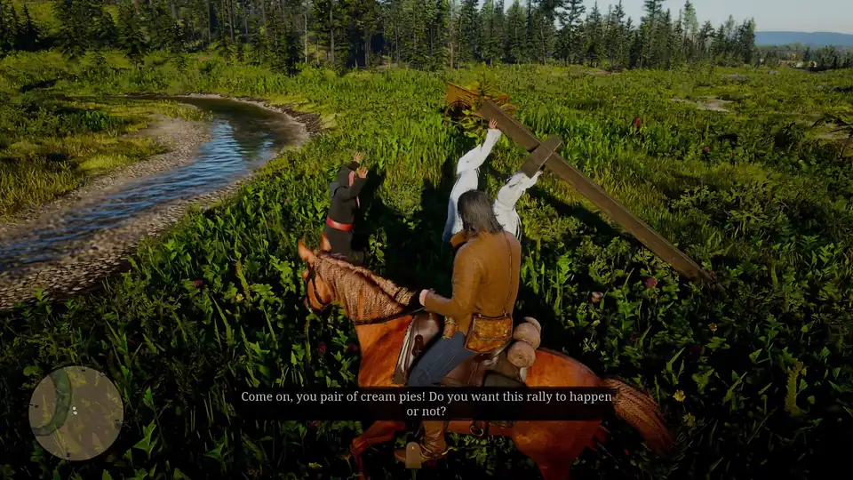
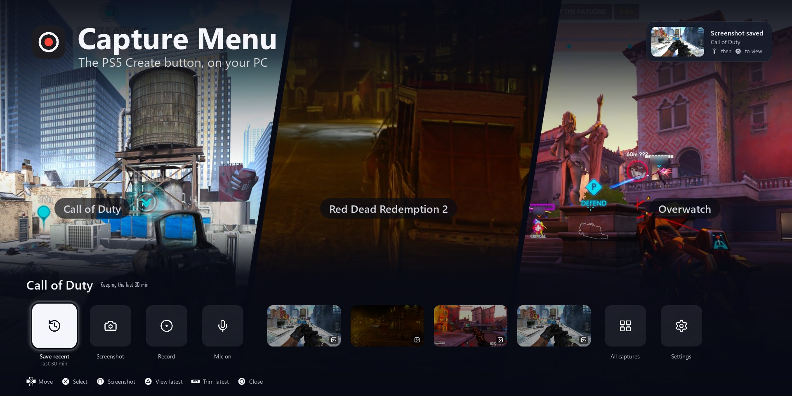

<p align="center">
  
</p>

<h1 align="center">Capture Menu</h1>

<p align="center">
  A PS5-style Create button for Windows.<br>
  Press <b>Alt + C</b> (or <b>Create</b> on your controller) to save the last minutes of gameplay, take a screenshot or record, without leaving the game.<br>
  Press it twice to save the last 30 seconds right away. Free, no account, no ads.
</p>

<p align="center">
  <a href="https://github.com/Amjz03/capture-menu/releases/latest"></a>
  <a href="https://github.com/Amjz03/capture-menu/releases"></a>
  
  <a href="LICENSE"></a>
</p>

<p align="center">
  <a href="https://github.com/Amjz03/capture-menu/releases/latest"><b>Download</b></a> ·
  <a href="https://amjz03.github.io/capture-menu/">Website</a> ·
  <a href="#install">Install</a> ·
  <a href="#using-it">Using it</a> ·
  <a href="docs/guide.md">Guide</a> ·
  <a href="docs/guide.md#troubleshooting">Troubleshooting</a>
</p>

<p align="center">
  
</p>

## Features

- **Save recent gameplay** from the last 30 minutes, kept on your drive (not in RAM): the last 15 s, 30 s, 1, 3, 5, 15 or 30 minutes, or everything.
- **Screenshot and record** from the same bar, with a small REC timer while you record.
- **A folder per game**, detected automatically, like the PS5. Clips and screenshots can go to different drives or folders.
- **Check it right away:** a viewer with play, skip and frame-exact trim.
- **Your voice louder or quieter, per clip:** your voice and the game are recorded on their own tracks, so each clip's balance can be changed afterwards, and changed back.
- **Share in one step:** copies for phones and Discord (10 / 50 / 500 MB) go straight to the clipboard, with or without your voice.
- **Gallery** with favorites, titles, notes, sizes, sorting and multi-delete.
- **Works with a controller:** DualSense, Xbox and most others, with on-screen hints that match.
- **Follows your game** across monitors and TVs, or always records the screen you pick. The menu shows in your clips and screen shares, but never in its own screenshots.
- **English and Arabic:** the whole interface, mirrored right to left in Arabic, like the PS5.
- **One-click install:** OBS Studio and FFmpeg are installed and set up for your PC automatically.

<p align="center">
  
</p>

| | | |
|---|---|---|
|  |  |  |
|  |  |  |

## Install

1. Download **`CaptureMenu-Setup.exe`** from the [latest release](https://github.com/Amjz03/capture-menu/releases/latest).
2. Double-click it and press **Install**. The first time takes a few minutes.

That's it: press **Alt + C** in a game. No admin rights and no Python needed.

**Or with winget**, in a terminal (OBS Studio and FFmpeg come with it):

```
winget install Amjz03.CaptureMenu
```

> **"Windows protected your PC"?** Click **More info → Run anyway**. Windows shows this for any app that isn't from the Store.

**Update:** when a new version is out, a notice says so. Click it, or open Settings → General → **Updates**, and press Enter to install. Capture Menu restarts by itself and keeps your settings and captures. Nothing is downloaded until you press.

**Remove:** Windows **Settings → Apps → Installed apps → Capture Menu → Uninstall**. Your captures, OBS and FFmpeg stay.

## Using it

Press **Alt + C** (or **Create** on the controller) in a game. A bar slides up along the bottom: pick **Save recent** and a length, take a **Screenshot**, or start a **Recording**. Press it twice quickly to save the last 30 seconds without the bar.

Every capture shows a notification; click it to watch, trim, change the voice/game balance or share it. **All captures** opens the gallery, sorted into a folder per game.

The [guide](docs/guide.md) has every key and controller button, the Settings page and `config.json`, disk use, and troubleshooting.

**Quick fixes:** if the bar doesn't show over a game, set the game to **Borderless** or **Windowed Fullscreen**. If clips record twice, turn off the NVIDIA app's Instant Replay. Logs are in `%LOCALAPPDATA%\Programs\CaptureMenu`.

## Development

Python, [PySide6](https://doc.qt.io/qtforpython-6/), [OBS Studio](https://obsproject.com/) over its WebSocket, [SDL2](https://www.libsdl.org/) and [FFmpeg](https://ffmpeg.org/). Running from source, tests, building and releasing are in [docs/development.md](docs/development.md).

## Code signing policy

Releases are not code-signed yet. The [release workflow](.github/workflows/release.yml) can sign through [SignPath.io](https://about.signpath.io), but that needs an approved SignPath project, which this repo doesn't have. Until it does, Windows shows no verified publisher; check the file's **Properties → Digital Signatures** if you want to be sure.

Release files are built only by that workflow on GitHub Actions, from the code in this repository, and only after `tests/run_release_tests.py` passes. Nothing built on a personal computer is published.

The updater checks every download against the SHA-256 that GitHub lists for the release, and won't run a file that doesn't match. That catches a broken or swapped download, not a compromised GitHub account.

- Committers and reviewers: [Amjz03](https://github.com/Amjz03)
- Approvers (who decide what is released): [Amjz03](https://github.com/Amjz03)

## Privacy

Capture Menu talks to OBS on your own PC. The only thing it sends out is a request to GitHub for the latest version number when it starts and once an hour, with nothing about you or your PC in it. Updates download only when you choose to install one. Your clips and screenshots stay on your PC (apart from what you send to your phone over your own Wi-Fi).

## Credits and license

- Button prompts: [PromptFont](https://shinmera.com/promptfont) by Shinmera (Yukari Hafner), SIL Open Font License 1.1 (`assets/PROMPTFONT-LICENSE.txt`). PlayStation and Xbox are trademarks of their owners.
- Interface icons: [Lucide](https://lucide.dev), ISC License (`assets/LUCIDE-LICENSE.txt`).

Capture Menu is released under the [MIT License](LICENSE).
