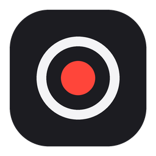
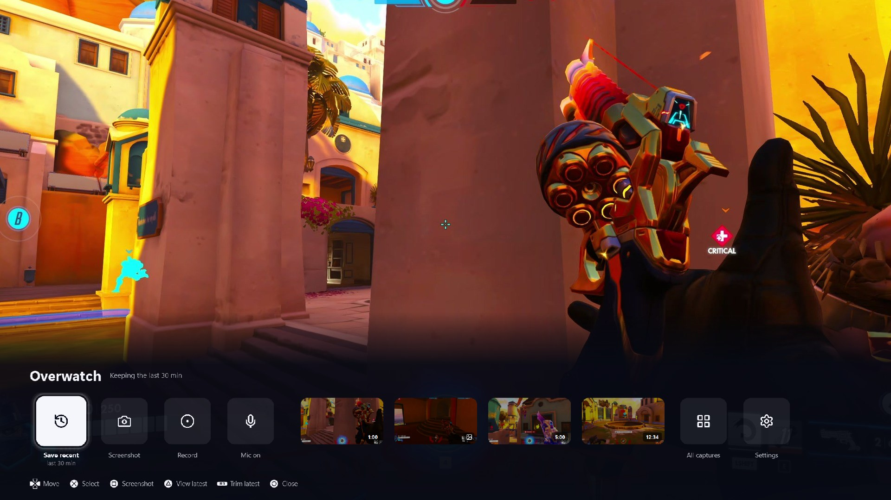
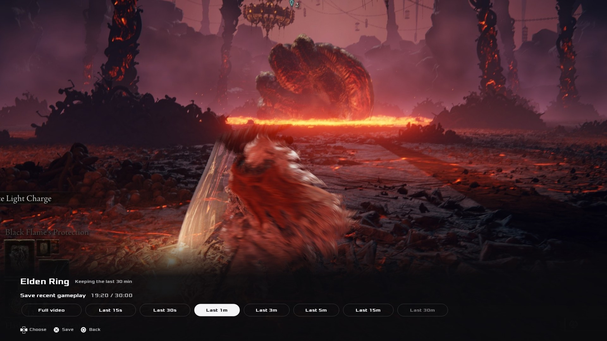
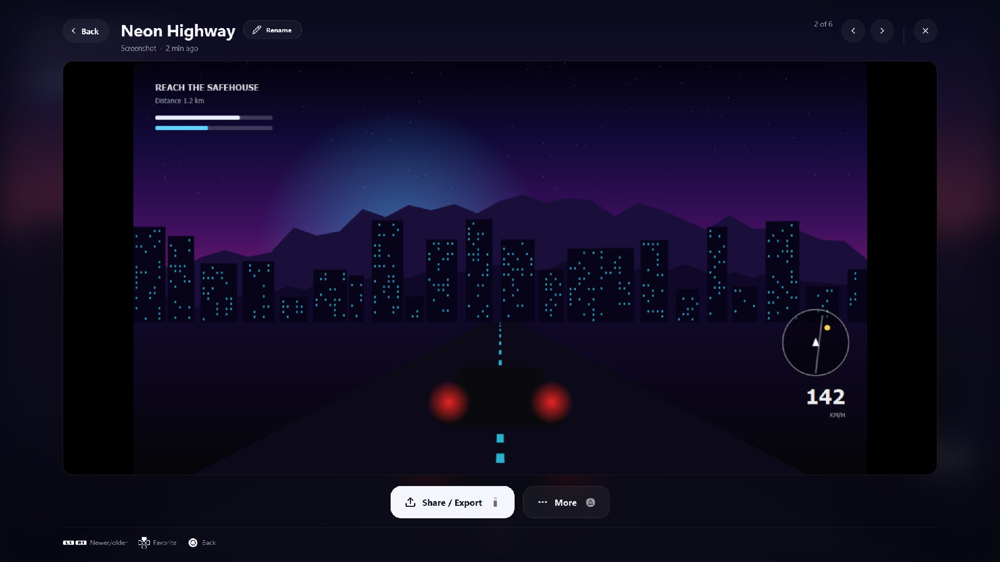
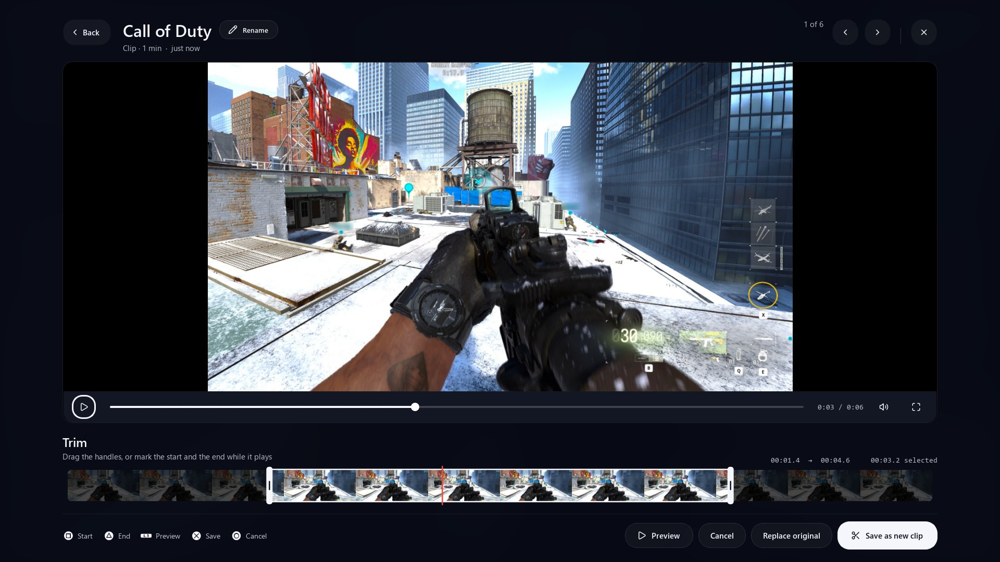
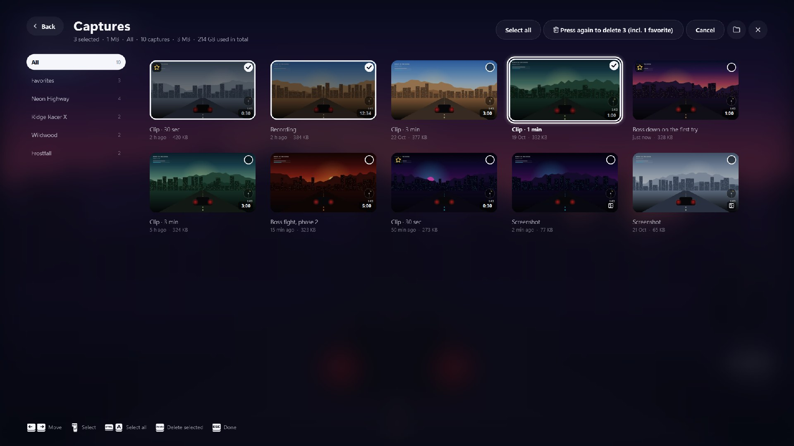
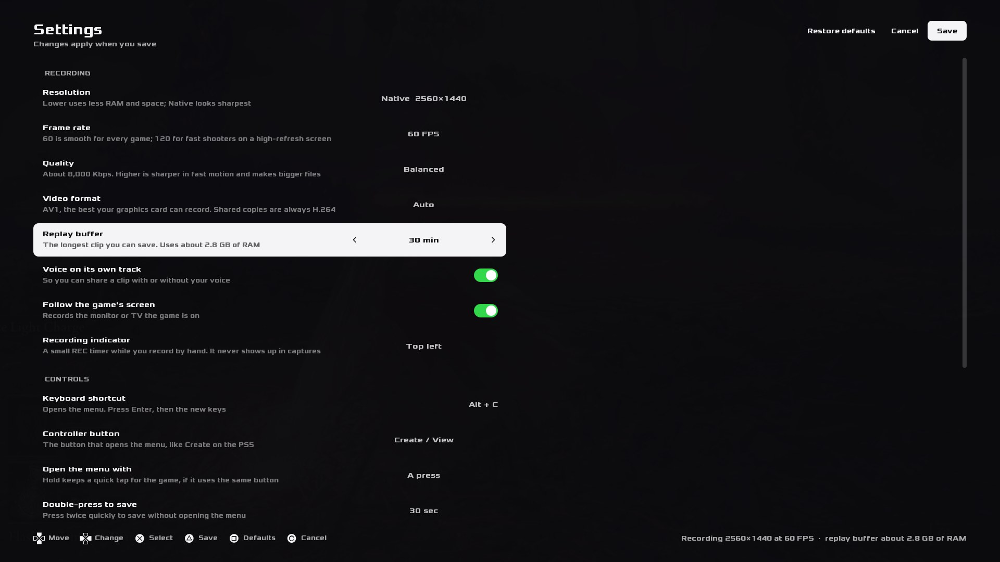
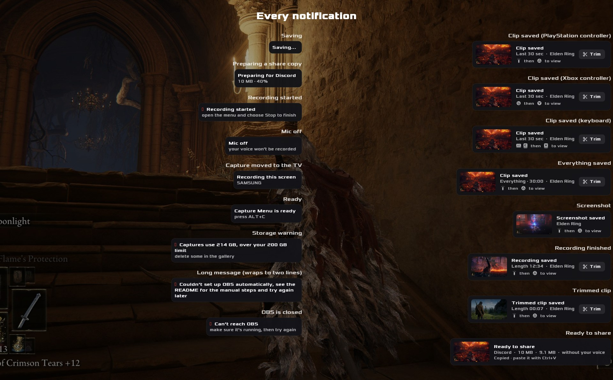

<p align="center">
  
</p>

<h1 align="center">Capture Menu</h1>

<p align="center">
  A PS5-style Create button for Windows.<br>
  Press <b>Alt + C</b> (or <b>Create</b> on your controller) to save the last minutes of gameplay, take a screenshot or record, without leaving the game.
</p>

<p align="center">
  <a href="https://github.com/Amjz03/capture-menu/releases/latest"><b>Download</b></a> ·
  <a href="#install">Install</a> ·
  <a href="#using-it">Using it</a> ·
  <a href="#settings">Settings</a> ·
  <a href="#troubleshooting">Troubleshooting</a>
</p>

<p align="center">
  
</p>

## Features

- **Save recent gameplay** from a 30-minute replay buffer: the last 15 s, 30 s, 1, 3, 5, 15 or 30 minutes, or everything.
- **Screenshot and record** from the same bar, with a small REC timer while you record.
- **A folder per game**, detected automatically, like the PS5. Clips and screenshots can go to different drives or folders.
- **Check it right away:** a viewer with play, skip and frame-exact trim.
- **Your voice louder or quieter, per clip:** your voice and the game are recorded on their own tracks, so each clip's balance can be changed afterwards, and changed back.
- **Share in one step:** copies for phones and Discord (10 / 50 / 500 MB) go straight to the clipboard, with or without your voice.
- **Gallery** with favorites, titles, notes, sizes, sorting and multi-delete.
- **Works with a controller:** DualSense, Xbox and most others, with on-screen hints that match.
- **Follows your game** across monitors and TVs, and never shows up in your recordings.
- **English and Arabic:** the whole interface, mirrored right to left in Arabic, like the PS5.
- **One-click install:** OBS Studio and FFmpeg are installed and set up for your PC automatically.

| | | |
|---|---|---|
|  |  |  |
|  |  |  |

## Contents

- [Install](#install)
- [Using it](#using-it): [the bar](#the-bar) · [controller](#with-a-controller) · [viewer](#viewer) · [trim](#trim) · [sound](#sound) · [share](#share) · [gallery](#gallery) · [more](#more)
- [Settings](#settings): [Settings page](#settings-page) · [`config.json`](#configjson)
- [Performance](#performance)
- [Troubleshooting](#troubleshooting)
- [Development](#development)
- [Code signing policy](#code-signing-policy)
- [Credits and license](#credits-and-license)

## Install

1. Download **`CaptureMenu-Setup.exe`** from the [latest release](https://github.com/Amjz03/capture-menu/releases/latest).
2. Double-click it and press **Install**. The first time takes a few minutes.

That's it: press **Alt + C** in a game. No admin rights and no Python needed.

> **"Windows protected your PC"?** Click **More info → Run anyway**. Windows shows this for any app that isn't from the Store.

Setup does the rest by itself:

- installs Capture Menu to `%LOCALAPPDATA%\Programs\CaptureMenu`
- installs **OBS Studio** and **FFmpeg** if you don't have them
- turns on OBS's WebSocket with a random password and saves it to `config.json`
- adds Capture Menu to the Start menu and to Windows startup, and starts it
- checks everything, and if something isn't ready, offers a log that says what to fix

**First start.** Capture Menu sets up OBS for your PC and restarts it once: your main screen's resolution at 60 FPS, the best encoder for your graphics card (RTX 40/50: AV1, older NVIDIA: HEVC, AMD/Intel: their hardware encoder), a bitrate that suits the resolution, the 30-minute replay buffer, MP4 recordings and a Display Capture source. You'll see *Setting up OBS · 2560×1440 · 60 FPS · NVENC AV1 8000 Kbps*, then *OBS is ready*. It only runs again if your main monitor or graphics card changes.

**Update:** Settings → General → **Updates** (or right-click the tray icon → Check for updates). It asks GitHub for a newer version; press again to download and install it, and Capture Menu restarts on its own. Nothing is downloaded or installed unless you press. Your settings and captures are kept.
**Remove:** Windows **Settings → Apps → Installed apps → Capture Menu → Uninstall**. Your captures, OBS and FFmpeg stay.

**Always on, out of the way.** Capture Menu starts with Windows and runs in the background with no window or taskbar button. A notice says *Capture Menu is running* when the PC starts, and its icon sits next to the clock: click it to open the bar, right-click for the gallery, Settings or Quit. OBS starts minimized to the tray too. Only one copy runs at a time.

## Using it

**Back, everywhere.** The viewer, the gallery, Settings and the Save recent row all have a **Back** button at the top. It goes one step back: a panel closes first, then you return to where you came from (the bar or the gallery). **Esc** and **◯ / B** on the controller do the same.

### The bar

Press **Alt + C** in a game or on the desktop. A bar slides up along the bottom of the screen, like the PS5 Create menu, so the game stays visible above it. **Create** has Save recent, Screenshot, Record and Mic; **Recent** has your last 4 captures plus All captures.

| Key | Action |
|---|---|
| ← → | Move between tiles (hovering with the mouse works too) |
| Enter | Select |
| ↑, or Enter on **Save recent** | Pick a length: Full video, Last 15 s, 30 s, 1 m, 3 m, 5 m, 15 m, 30 m |
| 1–8 | Save that length right away (1 = Full video, 2 = Last 15 s, …) |
| S / R | Screenshot / start or stop recording |
| V / T | View / trim the latest capture |
| M | Mic on / off |
| O | Open the gallery |
| , | Settings |
| Esc | Close (clicking back into the game closes it too) |

**Save recent** shows how much is recorded right now, e.g. `19:20 / 30:00`. Longer options are dimmed; picking one saves everything recorded so far. **Picked too short?** Open the bar again and pick a longer one: the new clip still has the moment, and both clips are kept.

**Double-press to save.** Press Alt + C or Create twice quickly to save the last 30 seconds without opening the bar.

**A folder per game.** Captures are saved by the game (or app) on screen when you press the shortcut:

```
Videos\Clips\
├── Cyberpunk 2077\
├── Elden Ring\
└── Desktop\        ← captures taken outside a game
```

A recording goes to the game it **started** in, even if you stop it somewhere else.

### With a controller

Press **Create** on a DualSense (the small button left of the touchpad), just like on the PS5. Xbox and most other controllers work too.

| Button (DualSense / Xbox) | In the bar | In the viewer | While trimming |
|---|---|---|---|
| D-pad or left stick | Move / pick a length | ← → skip 5 s | ← → skip 5 s |
| ✕ / A | Select | Play / pause | Save as a new clip |
| ◯ / B | Back / close | Close | Cancel |
| ▢ / X | Screenshot | Trim | Set start |
| △ / Y | View latest | Delete | Set end |
| L1 R1 / LB RB | | Newer / older | Preview |

On-screen hints follow what you're holding: ✕ ◯ ▢ △ for PlayStation, A B X Y for Xbox, keys as soon as you touch the keyboard. Change the button in [Settings](#settings).

### Viewer

Every capture shows a notification with its thumbnail; click it to open the capture, or its **Trim** button to trim it. In the bar, click a Recent capture or press **V**.

| Key | In the viewer |
|---|---|
| Space | Play / pause |
| ← → | Skip 5 seconds |
| A / D | Newer / older capture |
| T | Trim |
| V | Adjust audio: your voice and the game louder or quieter |
| E | Share / Export |
| M | More: Favorite, Rename, Show in folder, Open in your video player, Delete |
| N | Rename (a title and a note) |
| F | Favorite |
| Del | Delete (press twice; it goes to the Recycle Bin) |
| F11 | Only the video (Esc to come back) |
| Esc | Back |

The four big buttons under the video show the controller button that does each one: ▢ Trim, L3 Adjust audio, Options Share / Export, △ More. The video's own bar has play, the timeline, sound on / off and "only the video". If the built-in player can't show a clip's picture (for example AV1 without GPU decoding), a light 720p preview plays instead; the original is untouched.

### Trim

Press **T**. A filmstrip appears with two handles:

| Key | While trimming |
|---|---|
| Drag the handles | Set start and end (the video shows that frame) |
| I / O | Set start / end at the playhead |
| P | Preview the selection |
| Enter | Save as a new clip (the original stays) |
| Esc | Cancel |

**Replace original** keeps only the trimmed part and sends the full clip to the Recycle Bin. Trims are frame-exact, encoded on the GPU in the same format as the original. When that isn't possible, Capture Menu makes a fast lossless cut instead, which may start a second or two early.

### Sound

Too quiet next to the game, or too loud? In the viewer press **V** (L3 on the controller) or **Adjust audio**. Two cards appear, **Your voice** and **Game**, each with a volume bar and **Mute**: drag them, or use the arrows. **100%** is how it was recorded, 200% sounds twice as loud, 50% half as loud, 0% is muted (your voice goes up to 400%).

| Key | In Adjust audio |
|---|---|
| ↑ ↓ | Your voice / Game |
| ← → | Quieter / louder, 25% at a time |
| M (△) | Mute, or back to the level it had |
| P | Listen to 12 seconds from where you are, before saving |
| Enter | Save |
| Esc | Back |

Only the sound that players play (track 1) is rebuilt; the video and your separate voice and game tracks stay as they were recorded, so you can change it again any time, or set both back to **100%**. The clip keeps its name and its place in the gallery, and share copies use the new balance. Clips recorded with "Voice on its own track" off have no separate voice to change.

### Share

In the viewer press **E** (Options on the controller). Three cards, then **Export & copy**; ← → moves between them and Enter (✕) changes the one you're on:

| Card | Choices |
|---|---|
| Format | **MP4 for phones & apps** (H.264, up to 1080p, plays everywhere), or the **Original file** as it was saved |
| Your voice | **Include** it, or **Leave out** for the game sound only (when the clip has your voice on its own track) |
| Size limit | **No limit**, or **10 / 50 / 500 MB** to fit Discord (free / Nitro Basic / Nitro). Long clips drop to 720p or 480p; a clip too long for the limit asks you to trim it first |

Copies go into a `Shared` folder in the game's folder and are **copied to the clipboard**, so you can paste them straight into Discord or WhatsApp.

### Gallery

**All captures** in the bar (or **O**) lists everything: All, ★ Favorites, then each game with its count and size.

- Arrows move, **Enter** opens the viewer, **[ ]** (L1 / R1) switches game, **F** (△ / Y) stars.
- **S** sorts by Newest or **Largest**, which also puts the biggest games first.
- **Select** (top right) lets you pick captures with a click: every tile shows a circle that fills in when picked, and the top bar becomes **Select all · Delete · Cancel**. **Space** (▢ / X) or Ctrl+click picks one without pressing Select, **Ctrl+A** picks all, and **Del** deletes them to the Recycle Bin after a confirmation that mentions any favorites. Esc (◯ / B) stops selecting.

Titles like "Boss down on the first try" show in the viewer, Recent row and gallery, and name the copies you share; the file keeps its name.

### More

- **Mic.** The Mic tile (or **M**) mutes your microphone in OBS; it turns red when off.
- **Your voice on its own track.** Recordings carry 3 audio tracks: everything, game only and mic only. Players use the first, so clips sound normal; *Without my voice* uses the second.
- **Monitors and TVs.** The bar, notifications and viewer open on the screen of the window in front. When a game fills a screen, OBS switches to record that screen within about 2 seconds, scaled to your recording resolution. Alt-tabbing to another screen doesn't move it. The replay buffer keeps what was captured at the time, so minutes before a move show the old screen.
- **REC timer.** A manual recording shows a small red *REC 12:34* in a corner. Clicks go through it, and it never shows up in captures.
- **Storage warning.** Past 200 GB of captures, or under 20 GB free on the drive, you get a notice. Nothing is ever deleted for you.
- **Sounds and vibration.** A chime when a clip is saved, a shutter click for screenshots and a tone when recording starts; the controller buzzes too while you're using it. Replace the `.wav` files in `assets\sounds` with your own if you like.

## Settings

### Settings page

Open it from the **Settings** tile at the end of the bar, **,** on the keyboard, or the tray icon. Move with ↑ ↓, change with ← →, **S** (△ / Y) saves, **Esc** (◯ / B) cancels. **Restore defaults** goes back to the original setup.

- **Recording:** resolution (Native, 1440p, 1080p, 720p), frame rate (30, 60, 120), quality (Light, Balanced, High, Max), video format (Auto, AV1, HEVC, H.264), replay buffer (5 to 60 min), voice on its own track, follow the game's screen, REC indicator (top left, top right, off).
- **Controls:** keyboard shortcut, controller button, press or hold, double-press to save, rumble, sounds.
- **Library:** clips folder, screenshots folder (the clips folder unless you pick another), storage warning.
- **General:** start with Windows, language (same as Windows, English or العربية), updates.

The page shows how much RAM the buffer will use. Saving restarts Capture Menu; a changed recording setting also updates OBS and restarts it once. The video format never asks for more than your graphics card can do (AV1 on an older card falls back to HEVC).

### `config.json`

The Settings page writes to `config.json` in the install folder. You can also edit it while Capture Menu is closed.

| Setting | What it does |
|---|---|
| `resolution` / `fps` / `quality` / `video_codec` | Recording settings, as on the Settings page |
| `buffer_minutes` | Replay buffer length in minutes |
| `hotkey` | The shortcut, e.g. `alt+c`, `ctrl+shift+f8` or `f9` |
| `durations_seconds` | The lengths shown in Save recent, in seconds |
| `clips_dir` | Where clips and recordings go. Empty = `Videos\Clips` |
| `screenshots_dir` | Where screenshots go. Empty = the clips folder |
| `language` | `auto` (same as Windows), `en` or `ar` |
| `game_names` | Fix a game's folder name (see below) |
| `controller_button` | `create`, `ps`, `options`, `touchpad`, `mute`, `share` (Xbox Series), `view`, or a combo like `l1+r1` |
| `controller_hold_ms` | Hold time before the bar opens; `0` = on press. Use `400` if your game uses the same button |
| `double_press_seconds` | Seconds saved by a double press; `0` = off |
| `capture_follow_game` | `true`: OBS records the screen your game is on |
| `obs_display_source` | The OBS Display Capture source to switch. Empty = the first one |
| `obs_auto_setup` | `true`: set OBS up for this PC on first run |
| `voice_track` | Record your voice on its own audio track |
| `sounds` / `rumble` | Sound cues / controller vibration |
| `storage_warn_gb` | Warn past this many GB of captures; `0` = never |
| `start_with_windows` | Start Capture Menu when you sign in |

**Fixing a game's folder name.** The name comes from the game's exe. If a game shows up as something odd (like `Shipping`), map its exe name; find it in Task Manager → right-click the game → **Go to details**:

```json
"game_names": {
  "r5apex.exe": "Apex Legends",
  "FortniteClient-Win64-Shipping.exe": "Fortnite"
}
```

## Performance

OBS keeps the replay buffer in RAM, roughly bitrate × length. At 1440p / 60 FPS:

| Buffer | AV1 8000 Kbps (default) | HEVC 12000 Kbps |
|---|---|---|
| 10 min | ~0.6 GB | ~0.9 GB |
| 20 min | ~1.2 GB | ~1.8 GB |
| 30 min | ~1.8 GB | ~2.7 GB |

With your voice on its own track (the default), OBS records at constant quality, so busy scenes can use more, up to about 2.9 GB for 30 minutes at 1440p. For less RAM pick a shorter buffer, a lower resolution or **Light** quality, or set `"voice_track": false`.

Capture Menu itself uses about 75 MB while it waits. The video player loads only when you open a clip, and FFmpeg (thumbnails, trims, share copies) runs at below-normal priority so it never takes CPU from your game.

Clips are AV1 on recent cards. VLC, Chrome and Discord play them; the Windows Photos app needs the free *AV1 Video Extension* from the Microsoft Store. Choose HEVC in Settings if you share to apps that don't accept AV1.

## Troubleshooting

- **The bar didn't show up.** It opens on the screen of the window in front, so check your other monitors. Make sure you press **Alt** + C, not Ctrl.
- **The bar doesn't show over a game.** Set the game to **Borderless** or **Windowed Fullscreen**.
- **"Alt + C is taken by another app".** Pick another shortcut in Settings, or use the controller or the tray icon.
- **Clips record twice.** Turn off the NVIDIA app's Instant Replay (`Alt + Z` → Settings).
- **1080p monitor?** Recording at 1440p adds no detail; choose 1080p in Settings.
- **It froze.** If Capture Menu stops responding for more than 6 seconds, it writes where it was stuck to `crash.log`. Send that file with your report.
- **Logs.** `capture_menu.log`, `crash.log` and `setup.log` are in `%LOCALAPPDATA%\Programs\CaptureMenu`.

<details>
<summary><b>Set up OBS by hand</b> (only if the automatic setup can't)</summary>

1. **Sources → + → Display Capture.**
2. **Settings → Video:** Base and Output `2560x1440`, FPS `60`.
3. **Settings → Output** (Simple): Video Encoder `Hardware (NVENC, AV1)`, Video Bitrate `8000`, Recording Quality `Same as stream`, Recording Format `MP4`, **Enable Replay Buffer**, Maximum Replay Time `1800`.
4. **Tools → WebSocket Server Settings:** enable it, and copy the password into `obs_password` in `config.json`.

</details>

## Development

Capture Menu is a single Python file built on [PySide6](https://doc.qt.io/qtforpython-6/), [OBS Studio](https://obsproject.com/) through its WebSocket, [SDL2](https://www.libsdl.org/) for controllers and [FFmpeg](https://ffmpeg.org/) for thumbnails, trims and share copies.

```
capture_menu.py      the app
config.json          default settings
assets/              icon, sounds, button-prompt font, interface icons
installer/           Setup.exe (Inno Setup), the Python-version setup and uninstall scripts, build_exe.bat
tests/               feature tests
tools/               screenshot renders for the docs, benchmarks
docs/                images for this README
```

**Run from source:** double-click `installer\Setup.cmd`. It installs Python 3.12, the libraries, OBS and FFmpeg, and installs the app from this folder (run it again after changes). Or run `py -3 capture_menu.py` directly with the libraries from `requirements.txt`.

**Tests** are plain scripts that print `PASS` lines: `py -3 tests\test_trim.py <repo folder> <scratch folder>`. Several were written for Linux with `QT_QPA_PLATFORM=offscreen` and check non-Windows fallbacks.

**Build:** `installer\build_exe.bat` makes `dist\CaptureMenu\CaptureMenu.exe`, and `Output\CaptureMenu-Setup.exe` when [Inno Setup 6](https://jrsoftware.org/isinfo.php) is installed.

**Release:** change `VERSION` on `main` (e.g. to `v0.0.2`) and push. GitHub Actions builds `CaptureMenu-Setup.exe` and the Python `CaptureMenu.zip` on Windows and publishes them. Changes are listed in [CHANGELOG.md](CHANGELOG.md).

**Promo video:** `tools\render_promo.py` renders a 16:9 and a 9:16 video from the app's real screens.

## Code signing policy

Release files are built only by the [release workflow](.github/workflows/release.yml) on GitHub Actions, from the code in this repository. Nothing built on a personal computer is published.

- Committers and reviewers: [Amjz03](https://github.com/Amjz03)
- Approvers (who decide what is released): [Amjz03](https://github.com/Amjz03)

**Privacy:** Capture Menu doesn't send any information to other computers unless you ask it to. It talks to OBS on your own PC, and it contacts GitHub only when you click **Check for updates** (to see the latest version, and to download it if you choose to install it). Your clips and screenshots stay on your PC.

## Credits and license

- Button prompts: [PromptFont](https://shinmera.com/promptfont) by Shinmera (Yukari Hafner), SIL Open Font License 1.1 (`assets/PROMPTFONT-LICENSE.txt`). PlayStation and Xbox are trademarks of their owners.
- Interface icons: [Lucide](https://lucide.dev), ISC License (`assets/LUCIDE-LICENSE.txt`).

Capture Menu is released under the [MIT License](LICENSE).
